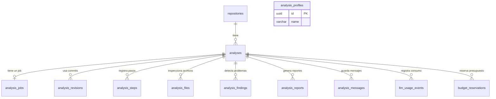

# Base de datos de Code Analysis Agent

**Proyecto:** `code-analysis-agent`  
**Motor:** PostgreSQL  
**ORM:** TypeORM  
**Base local:** `code_analysis`  
**Schema:** `public`

Este documento explica, de manera sencilla, las tablas creadas por la migración inicial del proyecto, cómo se relacionan y qué información se almacena en cada campo.

> **Importante:** el esquema está creado, pero muchas de estas tablas todavía no tienen funcionalidades implementadas en la API. Las explicaciones describen el **propósito previsto** de cada dato; no significan que el agente ya realice automáticamente todas estas operaciones.

---

## 1. Diagrama básico de las relaciones



### Cómo leerlo

- **`repositories` → `analyses`:** un repositorio puede tener muchos análisis.
- **`analyses` → tablas hijas:** cada análisis puede registrar muchos archivos, hallazgos, pasos, mensajes, reportes, etc.
- **`analyses` → `analysis_jobs`:** cada análisis puede tener **cero o un job**, porque `analysis_jobs.analysis_id` es único.
- **`analysis_profiles`:** no tiene una relación mediante clave foránea con otra tabla en el esquema actual. Guarda configuraciones reutilizables.
- **`typeorm_migrations`:** no aparece en el diagrama porque es una tabla técnica de TypeORM, no una entidad de negocio.

### Qué significan las claves

- **PK (Primary Key):** identifica de forma única un registro.
- **FK (Foreign Key):** apunta al identificador de una fila de otra tabla.
- **UUID:** identificador único, por ejemplo `550e8400-e29b-41d4-a716-446655440000`.
- **JSONB:** dato JSON almacenado por PostgreSQL; útil para configuraciones, listas y evidencias.
- **TIMESTAMPTZ:** fecha y hora con información de zona horaria.
- **NULL / opcional:** campo que puede no tener un valor.

---

## 2. El flujo completo, en palabras simples

1. Registrás un repositorio de GitHub en **`repositories`**.
2. Pedís un nuevo análisis y se crea una fila en **`analyses`**, que es la tabla principal.
3. Su trabajo de ejecución se guarda en **`analysis_jobs`**.
4. Se registran los commits que corresponden a las ramas en **`analysis_revisions`**.
5. Los pasos del procesamiento y los archivos investigados se guardan en **`analysis_steps`** y **`analysis_files`**.
6. Cada problema identificado se almacena en **`analysis_findings`**.
7. Se guarda el informe en **`analysis_reports`** y, si hay preguntas posteriores, los mensajes en **`analysis_messages`**.
8. El uso de modelos de IA y las reservas de dinero quedan en **`llm_usage_events`** y **`budget_reservations`**.

**Idea central:** casi todas las tablas se vinculan a `analyses` mediante `analysis_id`.

---

## 3. Explicación tabla por tabla

### 3.1. `repositories` — Repositorios registrados

Guarda la identificación del repositorio que se quiere investigar. No almacena una copia de todos sus archivos.

| Campo | Tipo | Qué guarda y para qué sirve |
|---|---|---|
| `id` | UUID, PK | Identificador interno del repositorio. |
| `provider` | TEXT | Proveedor de origen. Actualmente el valor permitido es `github`. |
| `owner` | TEXT | Usuario u organización propietaria del repositorio, por ejemplo `julianf97`. |
| `name` | TEXT | Nombre del repositorio, por ejemplo `code-analysis-agent`. |
| `created_at` | TIMESTAMPTZ | Fecha en que se registró. |

**Relación:** `repositories.id` se utiliza desde `analyses.repository_id`. La combinación `(provider, owner, name)` es única para evitar duplicados.

### 3.2. `analysis_profiles` — Configuraciones reutilizables

Permite almacenar una configuración con nombre para reutilizarla en diferentes análisis.

| Campo | Tipo | Qué guarda y para qué sirve |
|---|---|---|
| `id` | UUID, PK | Identificador del perfil. |
| `name` | VARCHAR(100) | Nombre único, por ejemplo `auditoria-rapida`. |
| `configuration` | JSONB | Configuración del perfil: categorías, profundidad, límites u otras opciones previstas. |
| `created_at` | TIMESTAMPTZ | Fecha de creación. |
| `updated_at` | TIMESTAMPTZ | Fecha de última actualización. |

**Relación:** actualmente no tiene ninguna FK. El análisis guarda su configuración efectiva en `analyses.config`.

### 3.3. `analyses` — La tabla principal

**Cada registro representa un análisis concreto** sobre un repositorio. Todas las demás tablas operativas dependen de este identificador.

| Campo | Tipo | Qué guarda y para qué sirve |
|---|---|---|
| `id` | UUID, PK | Identificador del análisis. |
| `repository_id` | UUID, FK | Repositorio al que pertenece. Apunta a `repositories.id`. |
| `mode` | TEXT | Modo: `directed` (pregunta específica) o `autonomous` (auditoría general). |
| `depth` | TEXT | Profundidad: `QUICK`, `STANDARD` o `DEEP`. |
| `question` | TEXT, opcional | Pregunta del usuario, especialmente útil para el modo dirigido. |
| `categories` | JSONB | Lista de áreas elegidas, por ejemplo `['security', 'architecture']` en formato JSON. |
| `branch` | TEXT | Rama principal solicitada, por ejemplo `main`. |
| `compare_branch` | TEXT, opcional | Segunda rama, cuando se hace una comparación. |
| `config` | JSONB | Configuración efectiva del análisis: límites, modelos, opciones y presupuesto previstos. |
| `status` | TEXT | Estado: `queued`, `running`, `completed`, `failed`, `cancelled` o `partial`. |
| `summary` | TEXT, opcional | Resumen general del resultado. |
| `error_message` | TEXT, opcional | Motivo del fallo cuando ocurre un error. |
| `created_at` | TIMESTAMPTZ | Momento en que se creó la solicitud. |
| `updated_at` | TIMESTAMPTZ | Última actualización del registro. |
| `completed_at` | TIMESTAMPTZ, opcional | Momento en que terminó el análisis. |

**Relación:** muchos análisis pueden pertenecer a un repositorio. `analyses.id` es la referencia principal de todas las tablas siguientes.

### 3.4. `analysis_jobs` — Trabajo pendiente o en ejecución

Representa el **job** que un worker deberá procesar. Separa la solicitud del análisis de su ejecución efectiva.

| Campo | Tipo | Qué guarda y para qué sirve |
|---|---|---|
| `id` | UUID, PK | Identificador del job. |
| `analysis_id` | UUID, FK, UNIQUE | Análisis que debe ejecutar. Un análisis no puede tener dos jobs registrados. |
| `status` | TEXT | `queued`, `running`, `completed`, `failed` o `cancelled`. |
| `attempts` | INTEGER | Cantidad de intentos realizados. Inicialmente `0`. |
| `max_attempts` | INTEGER | Número máximo de intentos permitidos. Inicialmente `3`. |
| `leased_by` | TEXT, opcional | Identificación del worker que se adjudicó el trabajo. |
| `lease_until` | TIMESTAMPTZ, opcional | Hasta cuándo tiene ese worker la reserva del job; ayuda a recuperar trabajos interrumpidos. |
| `error_message` | TEXT, opcional | Error registrado durante la ejecución. |
| `started_at` | TIMESTAMPTZ, opcional | Inicio efectivo del job. |
| `finished_at` | TIMESTAMPTZ, opcional | Finalización del job. |
| `created_at` | TIMESTAMPTZ | Fecha de creación del trabajo. |

**Relación:** `analysis_jobs.analysis_id` → `analyses.id`. Es una relación **uno a cero-o-uno** desde el análisis.

### 3.5. `analysis_revisions` — Ramas y commits examinados

Guarda la **versión exacta del código** sobre la que se hizo el análisis. El nombre de una rama puede cambiar de contenido, pero el SHA identifica un commit concreto.

| Campo | Tipo | Qué guarda y para qué sirve |
|---|---|---|
| `analysis_id` | UUID, FK, PK parcial | Identificador del análisis. |
| `kind` | TEXT, PK parcial | `base` (versión principal) o `comparison` (segunda versión comparada). |
| `branch` | TEXT | Nombre de la rama de la que se obtuvo el commit. |
| `commit_sha` | VARCHAR(40) | SHA completo del commit analizado. |

**Relación:** `analysis_revisions.analysis_id` → `analyses.id`. Su **clave primaria compuesta** es `(analysis_id, kind)`; permite un registro `base` y otro `comparison` por análisis.

### 3.6. `analysis_steps` — Etapas del proceso

Registra en qué etapa se encuentra o estuvo la investigación, útil para progreso, seguimiento y diagnóstico de errores.

| Campo | Tipo | Qué guarda y para qué sirve |
|---|---|---|
| `id` | UUID, PK | Identificador del paso. |
| `analysis_id` | UUID, FK | Análisis al que pertenece. |
| `name` | TEXT | Nombre del paso, por ejemplo `scan_files` o `generate_report`. |
| `status` | TEXT | Estado del paso. La migración no limita sus posibles valores. |
| `details` | JSONB, opcional | Información adicional de la etapa. |
| `started_at` | TIMESTAMPTZ | Momento de inicio. |
| `finished_at` | TIMESTAMPTZ, opcional | Momento de finalización. |

**Relación:** `analysis_steps.analysis_id` → `analyses.id`. La combinación `(analysis_id, name)` es única.

### 3.7. `analysis_files` — Archivos inspeccionados

Registra **qué archivos fueron revisados**, en qué commit y para qué categorías. No guarda automáticamente el contenido completo del archivo.

| Campo | Tipo | Qué guarda y para qué sirve |
|---|---|---|
| `analysis_id` | UUID, FK, PK parcial | Análisis que inspeccionó el archivo. |
| `path` | TEXT, PK parcial | Ruta dentro del repositorio, por ejemplo `src/db/index.ts`. |
| `commit_sha` | VARCHAR(40), PK parcial | Commit en el que se inspeccionó el archivo. |
| `categories` | JSONB | Áreas en las que se clasificó el archivo. Por defecto `[]`. |
| `inspected_at` | TIMESTAMPTZ | Fecha de inspección. |

**Relación:** `analysis_files.analysis_id` → `analyses.id`. La **PK compuesta** es `(analysis_id, path, commit_sha)`: permite registrar el mismo archivo en commits diferentes.

### 3.8. `analysis_findings` — Problemas y recomendaciones

Es la tabla de los **hallazgos** que después se podrán mostrar como tarjetas en la interfaz, ordenados por prioridad.

| Campo | Tipo | Qué guarda y para qué sirve |
|---|---|---|
| `id` | UUID, PK | Identificador del hallazgo. |
| `analysis_id` | UUID, FK | Análisis donde se detectó. |
| `fingerprint` | VARCHAR(64) | Huella para identificar el mismo hallazgo y evitar duplicados dentro de un análisis. |
| `title` | TEXT | Título corto del problema. |
| `category` | TEXT | Categoría, por ejemplo seguridad, base de datos o arquitectura. |
| `description` | TEXT | Explicación de qué se encontró. |
| `priority` | TEXT | Prioridad: `Critical`, `High`, `Medium` o `Low`. |
| `evidence` | JSONB | Evidencia estructurada: archivos, líneas, fragmentos o referencias. |
| `impact` | TEXT | Consecuencia o riesgo del problema. |
| `recommendation` | TEXT | Qué convendría hacer para resolverlo. |
| `action` | TEXT | Acción sugerida: `Keep`, `Refactor`, `Migrate` o `Remove`. |
| `justification` | TEXT | Motivo que respalda esa acción. |
| `confidence` | NUMERIC(4,3) | Confianza estimada, entre `0` y `1`. |
| `created_at` | TIMESTAMPTZ | Fecha del hallazgo. |

**Relación:** `analysis_findings.analysis_id` → `analyses.id`. La combinación `(analysis_id, fingerprint)` es única: el mismo análisis no debe guardar duplicado el mismo hallazgo.

### 3.9. `analysis_reports` — Informes generados

Permite guardar el informe en dos formatos, para usarlo tanto desde la API/UI como para leerlo o exportarlo.

| Campo | Tipo | Qué guarda y para qué sirve |
|---|---|---|
| `id` | UUID, PK | Identificador del reporte. |
| `analysis_id` | UUID, FK | Análisis al que pertenece. |
| `version` | INTEGER | Número de versión del reporte. |
| `json_document` | JSONB | Informe estructurado, pensado para procesarse desde código. |
| `markdown` | TEXT | Informe en Markdown, pensado para lectura o descarga. |
| `created_at` | TIMESTAMPTZ | Fecha de generación. |

**Relación:** `analysis_reports.analysis_id` → `analyses.id`. La combinación `(analysis_id, version)` es única.

### 3.10. `analysis_messages` — Conversaciones sobre el análisis

Guarda los mensajes enviados por el usuario y las respuestas del asistente asociadas a un análisis concreto.

| Campo | Tipo | Qué guarda y para qué sirve |
|---|---|---|
| `id` | UUID, PK | Identificador del mensaje. |
| `analysis_id` | UUID, FK | Análisis al que pertenece la conversación. |
| `role` | TEXT | Quién lo envió: `user` o `assistant`. |
| `content` | TEXT | Contenido textual del mensaje. |
| `created_at` | TIMESTAMPTZ | Fecha y hora del mensaje. |

**Relación:** `analysis_messages.analysis_id` → `analyses.id`. Un análisis puede tener muchos mensajes.

### 3.11. `llm_usage_events` — Consumo de inteligencia artificial

Registra **cada evento de consumo** de los modelos utilizados, para estimar costos y medir recursos.

| Campo | Tipo | Qué guarda y para qué sirve |
|---|---|---|
| `id` | UUID, PK | Identificador del consumo registrado. |
| `analysis_id` | UUID, FK | Análisis que ocasionó el consumo. |
| `model` | TEXT | Modelo utilizado, por ejemplo `gpt-4.1-mini`. |
| `task` | TEXT | Trabajo para el que se usó el modelo: clasificación, análisis, informe, etc. |
| `input_tokens` | INTEGER | Tokens de entrada consumidos. |
| `output_tokens` | INTEGER | Tokens de salida generados. |
| `estimated_cost_usd` | NUMERIC(12,6) | Costo estimado en dólares. No equivale necesariamente al cargo final facturado. |
| `created_at` | TIMESTAMPTZ | Fecha del evento. |

**Relación:** `llm_usage_events.analysis_id` → `analyses.id`. Un análisis puede generar muchos eventos.

### 3.12. `budget_reservations` — Reservas de presupuesto

Sirve para reservar una cantidad de dinero antes de consumirla, especialmente cuando habrá trabajos concurrentes.

| Campo | Tipo | Qué guarda y para qué sirve |
|---|---|---|
| `id` | UUID, PK | Identificador de la reserva. |
| `analysis_id` | UUID, FK | Análisis que utiliza la reserva. |
| `amount_usd` | NUMERIC(12,6) | Monto reservado en dólares; la base no permite valores negativos. |
| `released_at` | TIMESTAMPTZ, opcional | Momento en que se liberó la reserva. Si es `NULL`, sigue registrada como activa. |
| `created_at` | TIMESTAMPTZ | Momento en que se creó la reserva. |

**Relación:** `budget_reservations.analysis_id` → `analyses.id`. Un análisis puede tener varias reservas.

---

## 4. La tabla adicional `typeorm_migrations`

En DBeaver también aparece **`typeorm_migrations`**. No forma parte de las 12 entidades de negocio: **TypeORM la usa para registrar las migraciones que ya aplicó**.

Normalmente tiene columnas como:

| Campo | Para qué sirve |
|---|---|
| `id` | Identificador interno del registro de migración. |
| `timestamp` | Marca temporal asociada a la versión de la migración. |
| `name` | Nombre de la migración ejecutada. |

Así, al ejecutar nuevamente `npm run db:migrate`, TypeORM sabe qué migraciones ya se aplicaron. **No la edites ni borres manualmente**.

---

## 5. Ejemplo práctico: cómo se guardaría una investigación

Supongamos que querés investigar `julianf97/code-analysis-agent`, rama `main`:

1. **`repositories`**: se guarda `owner = julianf97`, `name = code-analysis-agent`.
2. **`analyses`**: se registra `mode = directed`, `question = ¿Qué problemas de seguridad hay?`, `depth = STANDARD`.
3. **`analysis_jobs`**: se guarda `status = queued` mientras espera ejecución.
4. **`analysis_revisions`**: se guarda el nombre de la rama y el SHA exacto que se revisará.
5. **`analysis_files`**: se registran las rutas de los archivos inspeccionados.
6. **`analysis_findings`**: se registra cada hallazgo con prioridad, evidencia y recomendación.
7. **`analysis_reports`**: se guarda el informe final en JSON y Markdown.
8. **`llm_usage_events`**: se registra el consumo estimado de tokens y dólares.
9. **`analyses.status`** y **`analysis_jobs.status`**: pasan a `completed` al finalizar satisfactoriamente.

Este es un **ejemplo del funcionamiento previsto**, no una ejecución comprobada del agente.

---

## 6. Consultas sencillas para DBeaver

Asegurate de abrir el editor SQL dentro de la base **`code_analysis`**.

**Ver todas las tablas del schema `public`:**

```sql
SELECT table_name
FROM information_schema.tables
WHERE table_schema = 'public'
  AND table_type = 'BASE TABLE'
ORDER BY table_name;
```

**Ver los análisis con su repositorio:**

```sql
SELECT
  a.id AS analysis_id,
  r.owner,
  r.name AS repository,
  a.branch,
  a.mode,
  a.depth,
  a.status
FROM public.analyses AS a
JOIN public.repositories AS r
  ON r.id = a.repository_id
ORDER BY a.created_at DESC;
```

Si devuelve cero filas, no significa que haya un error: las tablas pueden existir y todavía no contener datos.

---

## 7. Resumen para recordar

| Grupo | Tablas | Qué resuelven |
|---|---|---|
| **Origen** | `repositories` | Qué repositorio se investiga. |
| **Configuración** | `analysis_profiles`, `analyses` | Cómo se solicita y configura la investigación. |
| **Ejecución** | `analysis_jobs`, `analysis_steps`, `analysis_revisions` | Cuándo se ejecuta, por qué etapas pasa y qué commits utiliza. |
| **Resultados** | `analysis_files`, `analysis_findings`, `analysis_reports` | Qué se revisó, qué se encontró y cuál fue el informe. |
| **Interacción y costos** | `analysis_messages`, `llm_usage_events`, `budget_reservations` | Conversación, consumo y presupuesto. |
| **Interna de TypeORM** | `typeorm_migrations` | Historial de cambios del esquema. |

**Conclusión:** `analyses` es el centro del diseño. Cada investigación identifica un repositorio y desde allí se relacionan el trabajo, los archivos, las evidencias, los resultados, la conversación y los costos.
